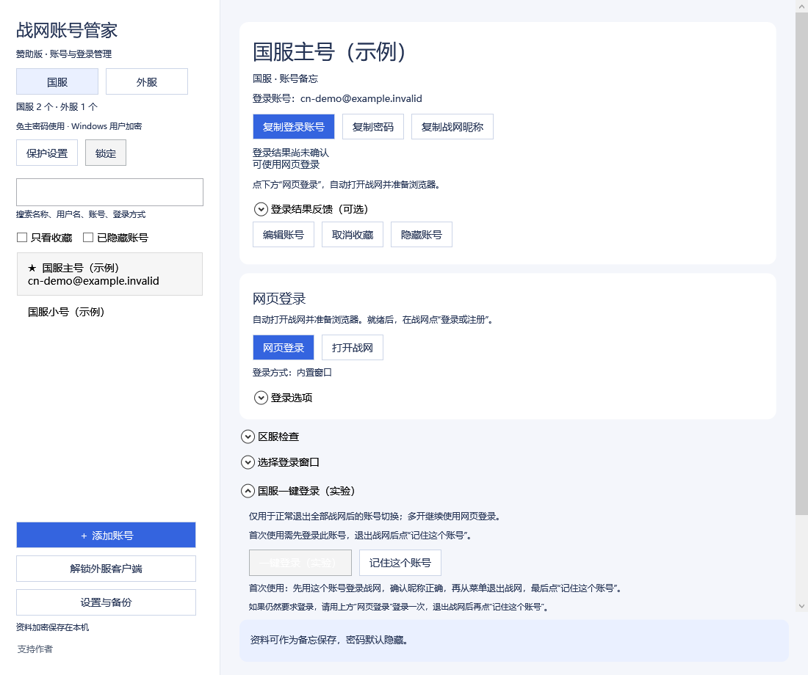
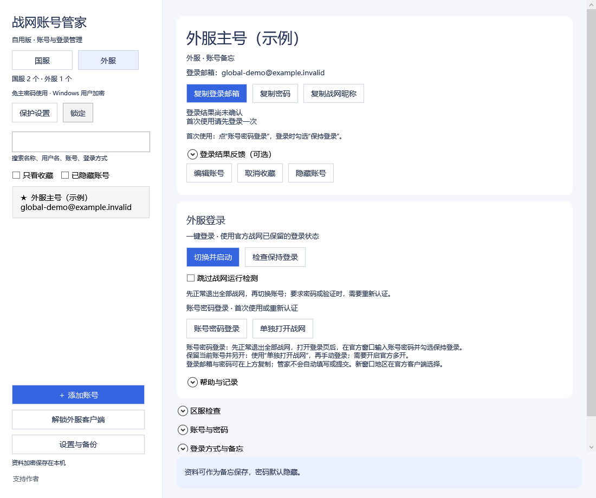
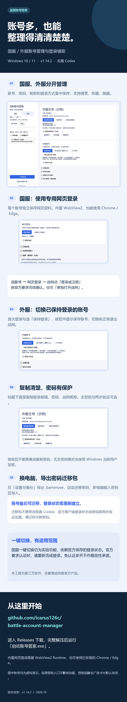

# 战网账号管家

Windows 上的国服 / 外服账号管理工具：账号备忘、密码库保护、独立网页登录，以及利用官方客户端已保留状态的账号切换。

**[下载 v1.14.7 赞助版](https://github.com/icarus126c/battle-account-manager/releases/tag/v1.14.7)** · [图文介绍](#图文介绍) · [使用说明](docs/使用说明.txt) · [密码保护说明](docs/保护说明.txt)

这是第三方工具，与暴雪、网易或支付宝没有官方隶属关系。首次登录、验证码、将军令及官方授权由使用者本人完成。



## v1.14.7 更新

- 补齐外服“单独打开战网”：优先使用待登录窗口，只有已登录窗口时另开一份，保留原账号。需要官方多开设置已开启，新窗口地区在官方客户端核对。
- 外服入口分为“切换并启动”“账号密码登录”“单独打开战网”，并将“检查保持登录”放到主要操作区。
- 外服独立启动可取消等待，不关闭已打开的客户端；补充切换后的保持登录开关诊断。

208 项相关检查通过，使用虚构资料。**外服切换后再次要求密码的根因尚未确认，本版不宣称解决所有免密码登录问题。** 真实账号多开及 A → B → A 切换仍需实测。



## v1.14.6 更新

- 国服“单独打开战网”优先使用待登录窗口；只有已登录窗口时另开一份，保留原账号。发现本次新窗口只表示客户端已打开，不代表登录成功，不会自动关闭登录页或浏览器。
- “网页登录”仍等待真正的登录页；取消等待会保留已打开的客户端。
- “设置与备份”新增“开启战网多开”和当前状态提示。首次修改前正常退出战网，不要退出登录；只修改多开开关，保留账号与保持登录设置。
- 完整备份边压缩边加密写入，兼容旧备份；改进临时 ZIP 清理及设置失败提示。
- 操作期间相关按钮置灰，取消等待仍可用。

13 组、317 项自用版检查通过，另完成分享版和赞助版构建与启动检查。检查使用虚构资料；真实客户端的登录结果仍需使用者确认。

## 开始使用

1. 下载 Release 中的 `battle-account-manager-1.14.7-sponsored-windows.zip`，完整解压。
2. 关闭旧版管家，运行“启动账号管家.exe”。无需安装 Codex 或开发环境。
3. 在国服或外服列表添加自己的账号。密码可以只作备忘，也可以不填。
4. 国服首次使用“网页登录”，按官方页面完成认证；外服首次登录时勾选“保持登录”。
5. 单账号切换前，从战网菜单正常“退出”，保留登录状态；按软件说明登记或切换账号。

运行需要 Windows、.NET Framework 4.7.2 或更新版本，以及已安装的官方战网。内置网页登录需要 Microsoft Edge WebView2 Runtime，也可选择 Chrome 或 Edge 的独立浏览器资料。

## 功能与范围

- 国服和外服分组，支持备注、搜索、收藏和隐藏账号。
- 账号标题下可分别复制登录邮箱、密码和战网昵称，复制结果就近显示；锁定后不可复制。
- 每个账号使用独立的内置 WebView2、Chrome 或 Edge 网页资料。
- 密码备忘在本机加密保存，可选主密码及验证器二次验证；支持锁定、备份恢复。
- 外服使用 TcNo 原版引擎切换官方客户端已保留的账号状态。
- 国服一键切换属于实验功能：依赖官方客户端实际保存的登录状态，失效时重新完成官方网页登录。
- 免认证多开不是可靠功能。多开时使用各账号独立的网页登录流程；本工具不会强制结束游戏。

不能保证登录状态永久有效，也不会绕过官方验证。启动流程完成不代表已成功登录，请核对战网中的昵称。

## 图文介绍

从账号整理、国服网页登录、外服切换，到密码保护和换电脑迁移，一张图了解主要功能。图中账号均为虚构示例。

[查看或保存介绍长图](docs/images/intro-long.png) · [介绍文案](docs/宣传文案.txt)



## 本机资料与隐私

默认资料目录：`%LOCALAPPDATA%\BattleAccountManager`。

- 账号和密码备忘：`data\vault-v2.bin`。
- 专用浏览器资料：`data\browser`。
- 历史备份及切换记录也保存在本机资料目录中；官方战网另外维护自身的登录凭据。

无主密码模式也使用 Windows 当前用户加密。本机资料与普通备份绑定 Windows 用户。换电脑请在“设置与备份”导出单独设置密码的 `.bammove` 迁移包，在新电脑输入该密码导入账号备忘；迁移包不携带浏览器或官方客户端登录状态，也不迁移密码库的两步验证设置。详见 [跨电脑迁移说明](docs/跨电脑迁移说明.txt)。

发布包不包含作者的账号库、密码、浏览器 Cookie 或客户端登录缓存。截图和测试账号均为虚构示例。版本发布核对结果见 [打包核对记录](docs/publication-audit.json)，下载校验值见 [SHA256](docs/SHA256.txt)。

分享时请发送原始 Release ZIP，不要把个人资料目录、备份或使用过的整个软件目录上传到公开仓库。

## 自愿赞助

**公开收款码给ai会回血。**

自愿支持，金额随意，不影响任何功能。软件左下角“支持作者”也可以打开同一个支付宝收款码。


赞助版也预留了可关闭的静态广告卡片，当前 `sponsor.json` 默认关闭，无广告 SDK、曝光统计或自动付款确认。配置说明见 [赞助配置](docs/赞助配置说明.txt)。

## 从源码构建

在 Windows PowerShell 中进入仓库目录：

```powershell
.\build.ps1 -Edition sponsored
Copy-Item .\sponsor.json .\release\sponsor.json
```

程序输出到 `release`。`Edition` 支持 `personal`、`friends`、`sponsored`。`src/Assets/alipay.png` 作为本地资源嵌入程序。

仅使用虚构资料的检查示例：

```powershell
Start-Process .\release\BattleAccountManager.exe -ArgumentList '--edition-test', "$PWD\edition-check.txt" -Wait
```

## 第三方组件

- TcNo Account Switcher v4.0.8：原版独立进程，GPLv3 许可在 `deps/Engine/LICENSE`，对应上游源码归档在 `ThirdParty`。
- Microsoft WebView2：许可与声明在 `deps/WebView2-LICENSE.txt` 和 `deps/WebView2-NOTICE.txt`。

本仓库保留第三方归属及对应源码，详情见 [组件说明](docs/第三方组件与源码.txt)。第三方许可仅适用于各自组件，不能据此推断整个管家已采用同一开源许可。
